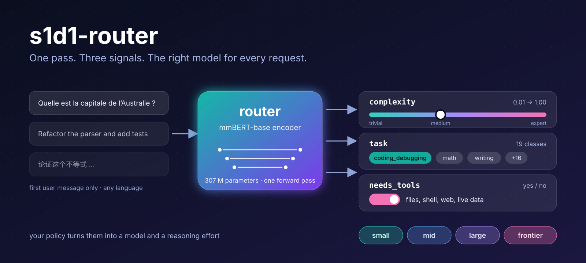

# s1d1-tantive

[](https://github.com/scombat/s1d1-tantive/actions/workflows/ci.yml) [](https://github.com/scombat/s1d1-tantive/actions/workflows/build.yml) [](https://github.com/scombat/s1d1-tantive/actions/workflows/image.yml) [](https://github.com/scombat/s1d1-tantive/releases) [](LICENSE) [](https://slsa.dev)
[](https://huggingface.co/scombat/s1d1-router) [](https://huggingface.co/collections/scombat/s1d1-router-6ad0f6b0a97a814b3e7f5b8d)

<p align="center"></p>

**s1d1** is a small multilingual model that reads a prompt once and returns a complexity score, a task (one of 19) and
whether the prompt needs tools. Four ONNX int8 variants (`full`, `compact`, `small`, `tiny`) are on [the Hub](https://huggingface.co/scombat/s1d1-router).

**s1d1-tantive** serves it as a decision service for LLM routers: System One and OpenAI Decisions for LiteLLM's Auto
Router and any decision client, chat-completions for older LiteLLM, vLLM-style `/classify` and TEI-style `/predict`
for everything else. One image per variant, for amd64 and arm64, signed and built with SLSA 3 provenance.

## What you get

- **Five formats on one model**: System One, OpenAI Decisions, chat-completions, vLLM `/classify`, TEI `/predict`, enabled by `S1D1_FORMATS`.
- **Batches**: up to 32 prompts per call, a result or an error per prompt.
- **Safe answers**: a fixed question catalogue, and a 422 for anything outside it.
- **Probabilities you can threshold**: tier probabilities calibrated by the model's own σ.
- **Long prompts handled**: `head_tail` by default, `chunks` when the middle matters.
- **Predictable latency**: one inference thread per vCPU, and a 503 + `Retry-After` when the deadline would be missed.
- **Observable**: Prometheus `/metrics` and OpenTelemetry (OTLP) traces and metrics.
- **Images you can trust**: multi-arch (amd64, arm64), signed keyless, with SBOM and SLSA 3 provenance.
- **Weights you can check**: `python -m tantive.verify` replays the checksum check anywhere.
- **One click to run**: seven deployment targets under `deploy/`.

## Deploy

One folder per target under `deploy/`, same image and variables everywhere.

[](https://portal.azure.com/#create/Microsoft.Template/uri/https%3A%2F%2Fraw.githubusercontent.com%2Fscombat%2Fs1d1-tantive%2Fmain%2Fdeploy%2Fazure%2Fazuredeploy.json) [](deploy/huggingface/PUBLISH.md) [](https://render.com/deploy?repo=https://github.com/scombat/s1d1-tantive) [](https://deploy.cloud.run/?git_repo=https://github.com/scombat/s1d1-tantive&dir=deploy/gcp) [](deploy/aws/README.md) [](https://www.heroku.com/deploy?template=https://github.com/scombat/s1d1-tantive)

A button that opens a guide instead of the provider has one step left for you, described in that guide.

## Documentation

- [Getting started](docs/getting-started.md): run the image, read `/info`, make a first call
- [LiteLLM](docs/litellm.md): the Auto Router, by the GUI and by `curl`
- [Formats](docs/formats.md): System One, Decisions, chat, `/classify`, `/predict`
- [Configuration](docs/configuration.md): variables, warm-up, shedding, metrics
- [Sizing](docs/sizing.md): how many replicas, how much memory, which deadline
- [Use cases](docs/use-cases.md): six ready-made configurations
- [Capture](docs/capture.md): keep the classified prompts to label them again
- [Verify the image](docs/verify.md): signature, provenance, weights
- Deploy guides: [`deploy/`](deploy/); release notes: [MAINTAINERS.md](MAINTAINERS.md); contributing: [CONTRIBUTING.md](CONTRIBUTING.md), [CODE_OF_CONDUCT.md](CODE_OF_CONDUCT.md); [CHANGELOG.md](CHANGELOG.md)

## Quickstart

```bash
docker run --rm -p 8788:8788 -e S1D1_FORMATS=systemone,decisions,chat,classify,predict \
  ghcr.io/scombat/s1d1-tantive:0.8.1-small-onnx-int8
```

```bash
curl localhost:8788/ready    # {"ready":true} once the model is warm, a few seconds after start
```

```bash
curl -s localhost:8788/v1/systemone -H 'content-type: application/json' -d '{
  "state": "What is the capital of Australia?",
  "questions": {"tier": {"type": "choice", "criteria": {"TRIVIAL": "", "LOW": "", "MEDIUM": "", "HIGH": "", "EXPERT": ""}}}}'
```

The answer, trimmed: `{"answers": {"tier": {"choice": "TRIVIAL", "confidence": 0.83, ...}}, "routing": {...}}`.
LiteLLM users: [docs/litellm.md](docs/litellm.md).

## Test it

Three prompts of increasing complexity, and the tier each lands on with the default tiers:

```bash
curl -s localhost:8788/classify -H 'content-type: application/json' -d '{"input": "Hello"}'    # label: TRIVIAL
```

```bash
curl -s localhost:8788/classify -H 'content-type: application/json' -d '{"input": "Write a Terraform module for an Azure Container App"}'    # label: MEDIUM
```

```bash
curl -s localhost:8788/classify -H 'content-type: application/json' -d '{"input": "Design a multi-region active-active payment system and prove its idempotency protocol is safe under network partition"}'    # label: HIGH
```

`GET /info` reports the loaded variant, its revision and the tier bounds.

## Verify the image

```bash
cosign verify ghcr.io/scombat/s1d1-tantive:<version>-small-onnx-int8 \
  --certificate-identity-regexp '^https://github.com/scombat/s1d1-tantive/\.github/workflows/build\.yml@refs/tags/v' \
  --certificate-oidc-issuer https://token.actions.githubusercontent.com
```

```bash
docker run --rm --entrypoint python ghcr.io/scombat/s1d1-tantive:0.8.1-small-onnx-int8 -m tantive.verify /model /model/checksums.json
```

The first checks the keyless signature (0.6.0 and later; `cosign.pub` verifies 0.5.0 and older), the second the weights; SLSA provenance too: [docs/verify.md](docs/verify.md).

## LiteLLM

1. *Add Model*: mode *Decisions*, provider `laya`, model `multilingual`, `api_base` = this service's URL.
2. *Auto Router*: classifier `oss_classifier` pointing at that model, a model for each of LiteLLM's tiers (`SIMPLE`,
   `MEDIUM`, `COMPLEX`, `REASONING`), `classifier_fallback: default_model`.
3. *Test Routing* on a few prompts. The GUI and `curl` routes, side by side: [docs/litellm.md](docs/litellm.md).

## Licence

Business Source License 1.1: free for non-production use, production use by agreement with the licensor, and Apache-2.0
on the change date. See [LICENSE](LICENSE).

| Project | Licence | Why |
|---|---|---|
| [s1d1-router](https://huggingface.co/scombat/s1d1-router) (the model) | Apache-2.0; the base model, mmBERT-base, is MIT | open weights, reusable anywhere |
| [s1d1-alliance](https://github.com/scombat/s1d1-alliance) (the free community instance) | Apache-2.0 | community infrastructure, made to be forked |
| s1d1-tantive (this repository) | BSL 1.1, which becomes Apache-2.0 four years after each release | free for non-production use; production use by agreement while it funds the project |

Security: see [SECURITY.md](SECURITY.md).
